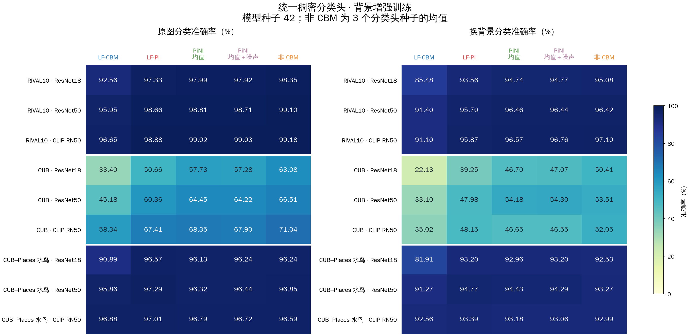
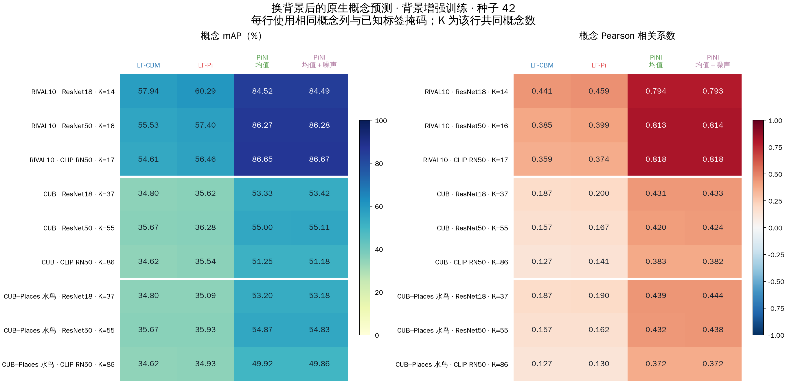

# Pi-CBM-Benchmark

比较 LF-CBM、LF-Pi、共享空间加噪 PiNI，以及不经过概念层的标准分类器。评测覆盖概念预测、充分概念连接下的分类能力、准确率—NEC 曲线和训练／测试分布偏移。

## 固定的方法版本

- `methods/LF-Pi`：LF-CBM 基线与 LF-Pi，跟踪 `main`。
- `methods/PiNI`：共享空间加噪版本，跟踪 `simplified-spatial-noise`。

评测代码位于 `benchmark/`，实验设置位于 `configs/`。两个子模块的模型、噪声生成和损失函数保持原样；数据适配、骨干接口、分类头容量扫描和结果统计在本仓库实现。

```bash
git clone --recurse-submodules https://github.com/Dodocheshire/Pi-CBM-Benchmark.git
```

## 评测设置

评测配置见 [configs/matrix.yaml](configs/matrix.yaml)。先运行一个种子检查数据与方法匹配，再执行三个种子。原图训练和背景增强训练分开比较，所有方法共用图像清单与冻结骨干版本。

概念指标分别统计人工逐图标注 mAP／相关系数、类级概念标签和 CLIP 教师相关性。概念映射由训练数据或官方属性名称决定。CIFAR 的 LF 方法拟合连续 CLIP 教师值，PiNI 使用仅在训练集确定 Otsu 阈值的伪二值概念标签。非 CBM 对照在同一图像特征上直接训练分类头。

NEC 网格根据数据集与概念库规模设置，同时保留 NEC=5 和 5–30 的参考区间。参考 [VLG-CBM §5.1 与附录 F](https://arxiv.org/html/2408.01432v3)：使用 GLM-SAGA 正则化路径，选取 NEC 接近目标的权重，再按目标预算剪除最小连接。横轴使用最终权重的实际 NEC，每个点保存每类连接数与原始路径位置。充分 NEC 对照使用验证集选择的全路径模型和稠密分类头。

主要结果：

- 原生概念与换背景：[同条件评测](reports/EXPERIMENT_REPORT.md)、[三个训练种子](reports/SEED_RESULT.md)、[非 CBM 对照](reports/NONCBM_RESULT.md)。
- 分类头容量：[稀疏／稠密分类头](reports/GENERALIZATION_RESULT.md)、[多种子 NEC 曲线](reports/NEC_SEED_RESULT.md)。
- CIFAR 泛化：[原图与官方 CIFAR-C](reports/CIFAR_RESULT.md)、[官方 CIFAR-C NEC 曲线](reports/CIFAR_NEC_RESULT.md)。

补充结果：[扰动下的概念预测与激活变化](reports/OOD_CONCEPT_RESULT.md)、[扰动 NEC 曲线](reports/OOD_NEC_RESULT.md)、[LF-Pi 注入位置](reports/LF_SITE_RESULT.md)、[大规模数据集](reports/SCALE_RESULT.md)。数据、模型和逐图预测写入忽略的 `artifacts/`。

`python -m benchmark.ood_full_queue` 在显存连续三次达到 16 GiB 后，串行导出三个有原生概念标注数据集的完整 PiNI 概念值，用于固定分类头的扰动 NEC 评测。每组使用同一批 256 张测试图和 13 个原图／腐蚀设置；输出位于独立的 `artifacts/ood_fullraw/`。新增保存逻辑核验见 [完整概念导出入口](reports/pini_ood_full_export_cpu_audit.json)。

## 已完成的主要评测

| 数据集 | 骨干 | 方法与训练条件 |
| --- | --- | --- |
| RIVAL10、CUB、CUB–Places Waterbirds | ImageNet ResNet18、ResNet50、CLIP RN50 | LF-CBM／LF-Pi 原图与背景增强训练，PiNI 均值／均值加噪，非 CBM 对照 |
| CIFAR-10、CIFAR-100 | ImageNet ResNet18、ResNet50、CLIP RN50 | LF-CBM／LF-Pi 原图与高斯噪声增强训练；非 CBM 对照；官方 CIFAR-C 四类扰动、12 个设置 |
| CIFAR-10 | ImageNet ResNet18、ResNet50 | PiNI 均值／均值加噪；官方 CIFAR-C 四类扰动、12 个设置 |
| CIFAR-10 | CLIP RN50 | PiNI 均值／均值加噪；原图与高斯噪声测试 |
| CIFAR-100 | ImageNet ResNet18 | PiNI 均值／均值加噪；官方 CIFAR-C 四类扰动、12 个设置 |
| ImageNet 每类 200 张训练图、Places365 | ImageNet ResNet18 | LF-CBM／LF-Pi、非 CBM、稀疏与稠密分类头 |

三个原生概念数据集的共享骨干 LF-CBM／LF-Pi 使用 42、43、44 三个训练种子；PiNI 使用原入口固定的种子 42。非 CBM 的三个种子对应冻结特征上的分类头训练。CUB 另包含仅在官方训练划分训练的 ResNet18 对照。

泛化评测包括换背景、主体／背景分离，以及高斯噪声、高斯模糊、对比度和 JPEG 压缩。官方 CIFAR-C 每个设置使用全部 10000 张测试图；三个原生概念数据集的腐蚀评测使用 ImageNet ResNet18 和固定 256 张图。各方法的原图与扰动测试使用同一批图像编号。

RIVAL10 的 LF-Pi 图像层、内部层、全局特征层比较已完成。图像层与内部层各包含原图训练和背景增强训练，结果见 [注入位置比较](reports/LF_SITE_RESULT.md)。

本轮评测的实际覆盖、子模块版本与产物校验见 [完成清单](reports/benchmark_completion.json)。

## 主要对照总览





## 运行入口

- 原生概念数据：`python -m benchmark.lf_matched --help`、`python -m benchmark.pini_matched --help`。
- CIFAR 的 LF-CBM／LF-Pi：`python -m benchmark.lf_cifar --help`。
- PiNI CIFAR：`python -m benchmark.pini_cifar --help`；宽骨干：`python -m benchmark.pini_cifar_wide --help`。
- 相同概念输出上的稀疏／稠密分类头：`python -m benchmark.head_suite --help`。
- CIFAR 图表：`python -m benchmark.report_cifar`。
- 容量与多种子图表：`python -m benchmark.report_generalization`、`python -m benchmark.report_nec_seeds`。
- 原生数据总览：在容量图表更新后运行 `python -m benchmark.report_overview`。

本机环境为 `/home/pengcheng/miniconda3/envs/pi-cbm/bin/python`。数据、区域缓存、训练权重和逐图预测存放在忽略的 `artifacts/` 中；图表与紧凑统计保存在 `reports/`。

## 本机输入准备

本轮使用 Python 3.11.15。安装根目录及所用子模块的依赖后，在仓库根目录执行上述入口。当前数据与模型位置：

- CIFAR、ImageNet、Places 数据：`/home/pengcheng/VLG-CBM/datasets`。
- PiNI 原始图像、划分和区域缓存：`/home/pengcheng/Pi-CBM/PiNI/artifacts`，由 `benchmark/pini_matched.py` 的 `SOURCE` 指定。
- Grounding DINO：`/home/pengcheng/Pi-CBM/D-Pi/artifacts/models/grounding-dino-tiny`。

新机器需准备这些输入并调整对应入口的路径；共享特征和逐图预测由评测入口写入 `artifacts/common/` 等目录，每组 manifest 保存图像编号、划分和来源校验值。
