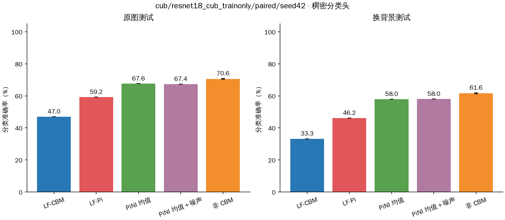
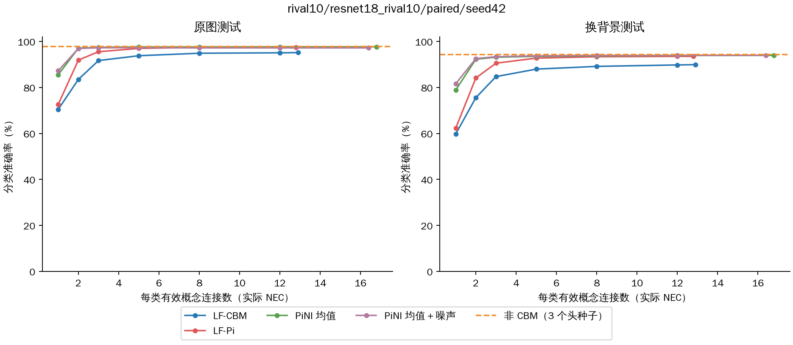
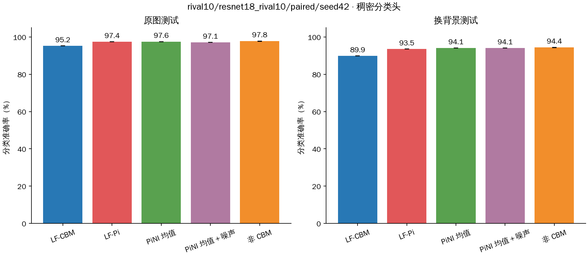
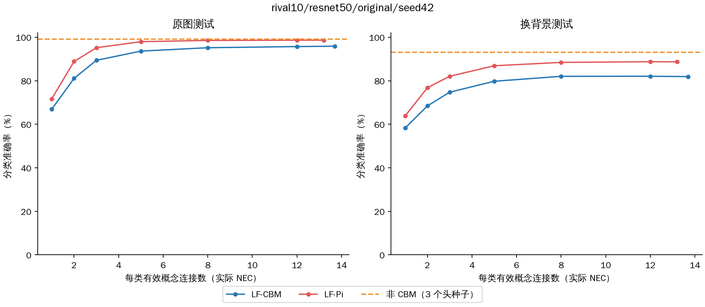

# 泛化与分类头容量

## cifar10/clip_RN50/original/seed42

## cifar10/resnet18/corruption_augmented/seed42

## cifar10/resnet18/original/seed42

## cifar10/resnet50/original/seed42

## cifar100/clip_RN50/original/seed42

## cifar100/resnet18/corruption_augmented/seed42

## cifar100/resnet18/original/seed42

## cifar100/resnet50/original/seed42

## cub/clip_RN50/original/seed42

## cub/resnet18/original/seed42

## cub/resnet18/paired/seed42

## cub/resnet18_cub_trainonly/original/seed42

## cub/resnet18_cub_trainonly/paired/seed42

## cub/resnet50/original/seed42

## cub/resnet50/paired/seed42

## imagenet_200_per_class/resnet18/original/seed42

## places365/resnet18/original/seed42

## rival10/clip_RN50/original/seed42

## rival10/clip_RN50/paired/seed42

## rival10/resnet18/original/seed42

## rival10/resnet18/paired/seed42

## rival10/resnet18_rival10/original/seed42

## rival10/resnet18_rival10/paired/seed42

## rival10/resnet50/original/seed42

## rival10/resnet50/paired/seed42

## waterbirds/clip_RN50/original/seed42

## waterbirds/clip_RN50/paired/seed42

## waterbirds/resnet18/original/seed42

## waterbirds/resnet18/paired/seed42

## waterbirds/resnet50/original/seed42

## waterbirds/resnet50/paired/seed42

## cifar10/clip_RN50/original/seed42 · 官方 CIFAR-C · 固定分类头

## cifar10/resnet18/corruption_augmented/seed42 · 官方 CIFAR-C · 固定分类头

## cifar10/resnet18/original/seed42 · 官方 CIFAR-C · 固定分类头

## cifar10/resnet50/original/seed42 · 官方 CIFAR-C · 固定分类头

## cifar100/clip_RN50/original/seed42 · 官方 CIFAR-C · 固定分类头

## cifar100/resnet18/corruption_augmented/seed42 · 官方 CIFAR-C · 固定分类头

## cifar100/resnet18/original/seed42 · 官方 CIFAR-C · 固定分类头

## cifar100/resnet50/original/seed42 · 官方 CIFAR-C · 固定分类头

## CUB 图像扰动

本组采用单次噪声采样。

## RIVAL10 图像扰动

本组采用单次噪声采样。

## WATERBIRDS 图像扰动

本组采用单次噪声采样。

