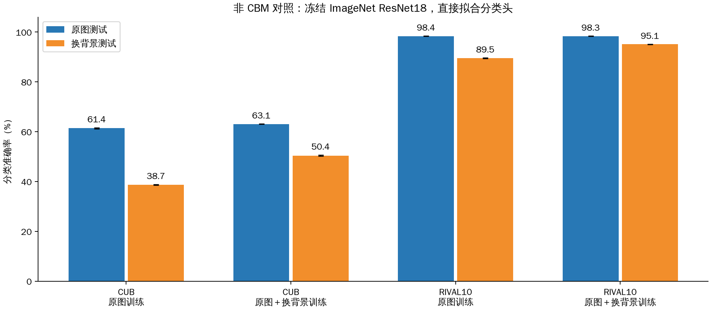

# 非 CBM 对照

使用冻结骨干输出直接训练线性分类头。四组固定学习率／权重衰减组合按验证集 NLL 选择，三个训练种子为 42、43、44。

| 数据与骨干 | 训练视图 | 原图准确率 | 换背景准确率 | 高斯噪声准确率 |
| --- | --- | --- | --- | --- |
| CIFAR-100／CLIP RN50 | 原图 | 66.87% ± 0.09 | — | — |
| CIFAR-100／ResNet18 | 原图 | 70.11% ± 0.10 | — | — |
| CIFAR-100／ResNet18 | 原图＋高斯噪声 | 68.71% ± 0.09 | — | 53.37% ± 0.10 |
| CIFAR-100／ResNet50 | 原图 | 73.24% ± 0.08 | — | — |
| CIFAR-10／CLIP RN50 | 原图 | 85.79% ± 0.12 | — | — |
| CIFAR-10／ResNet18 | 原图 | 88.43% ± 0.08 | — | — |
| CIFAR-10／ResNet18 | 原图＋高斯噪声 | 87.32% ± 0.10 | — | 75.64% ± 0.18 |
| CIFAR-10／ResNet50 | 原图 | 91.54% ± 0.05 | — | — |
| CUB／CLIP RN50 | 原图 | 70.65% ± 0.38 | 33.17% ± 0.48 | — |
| CUB／CLIP RN50 | 原图＋换背景 | 71.04% ± 0.26 | 52.05% ± 0.10 | — |
| CUB／ResNet18 | 原图 | 61.40% ± 0.20 | 38.67% ± 0.16 | — |
| CUB／ResNet18 | 原图＋换背景 | 63.08% ± 0.06 | 50.41% ± 0.22 | — |
| CUB／ResNet50 | 原图 | 65.22% ± 0.13 | 41.93% ± 0.03 | — |
| CUB／ResNet50 | 原图＋换背景 | 66.51% ± 0.09 | 53.51% ± 0.21 | — |
| ImageNet 1000 类／ResNet18 | 原图 | 66.48% ± 0.20 | — | — |
| Places365／ResNet18 | 原图 | 37.44% ± 0.14 | — | — |
| RIVAL10／CLIP RN50 | 原图 | 99.22% ± 0.02 | 92.54% ± 0.18 | — |
| RIVAL10／CLIP RN50 | 原图＋换背景 | 99.18% ± 0.03 | 97.10% ± 0.10 | — |
| RIVAL10／ResNet18 | 原图 | 98.37% ± 0.07 | 89.49% ± 0.13 | — |
| RIVAL10／ResNet18 | 原图＋换背景 | 98.35% ± 0.05 | 95.09% ± 0.03 | — |
| RIVAL10／ResNet50 | 原图 | 99.17% ± 0.01 | 93.13% ± 0.10 | — |
| RIVAL10／ResNet50 | 原图＋换背景 | 99.10% ± 0.06 | 96.42% ± 0.07 | — |
| CUB–Places 水鸟二分类／CLIP RN50 | 原图 | 96.27% ± 0.08 | 68.97% ± 1.36 | — |
| CUB–Places 水鸟二分类／CLIP RN50 | 原图＋换背景 | 96.59% ± 0.09 | 92.99% ± 0.13 | — |
| CUB–Places 水鸟二分类／ResNet18 | 原图 | 95.60% ± 0.04 | 80.01% ± 0.40 | — |
| CUB–Places 水鸟二分类／ResNet18 | 原图＋换背景 | 96.24% ± 0.08 | 92.53% ± 0.16 | — |
| CUB–Places 水鸟二分类／ResNet50 | 原图 | 95.58% ± 0.06 | 74.99% ± 0.72 | — |
| CUB–Places 水鸟二分类／ResNet50 | 原图＋换背景 | 96.85% ± 0.05 | 93.27% ± 0.30 | — |

各组使用本轮共用的冻结骨干特征。误差为独立分类头训练种子间的标准差。
