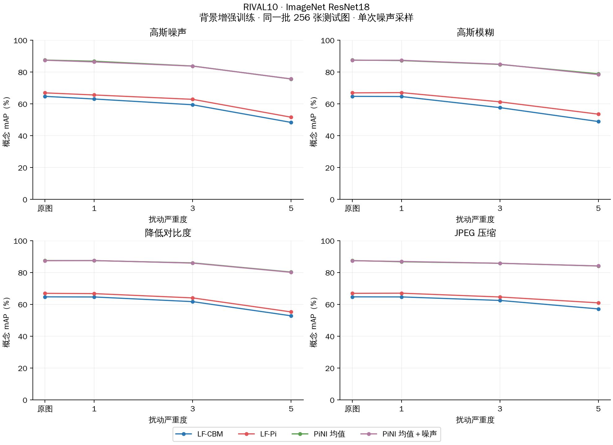
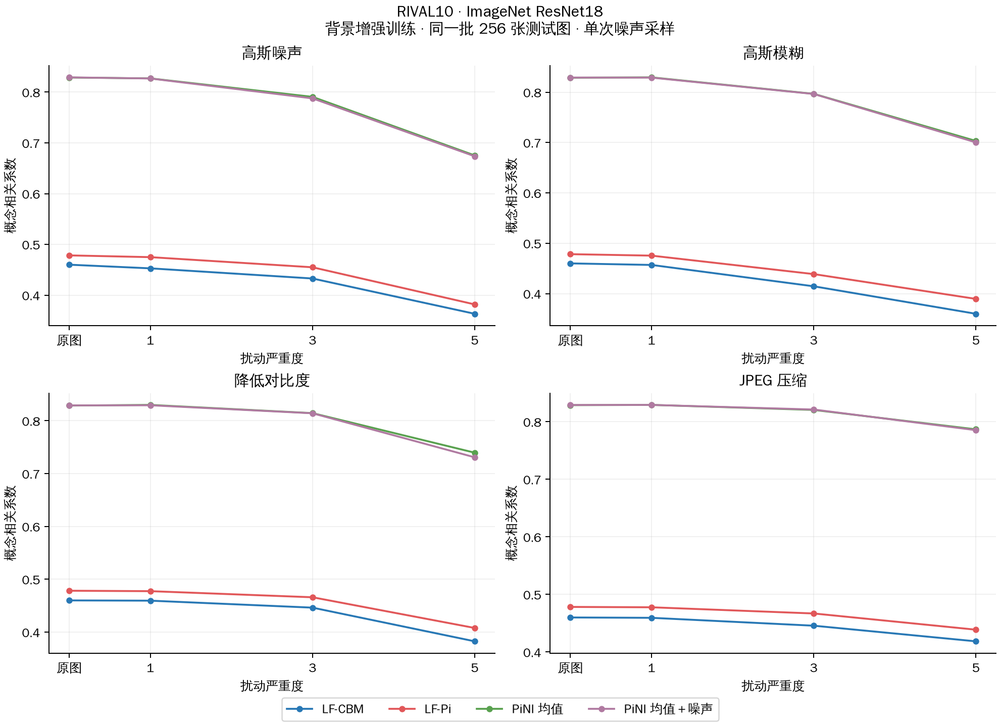
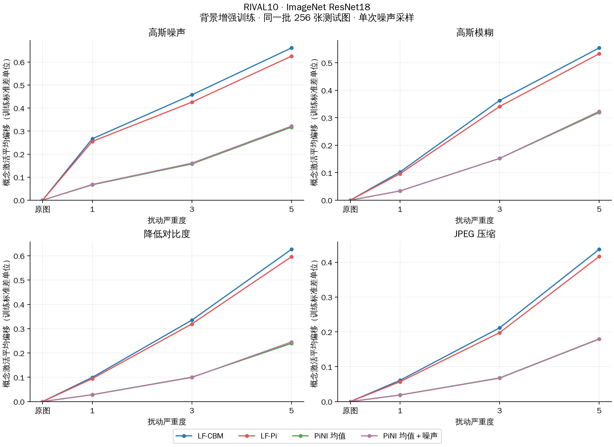
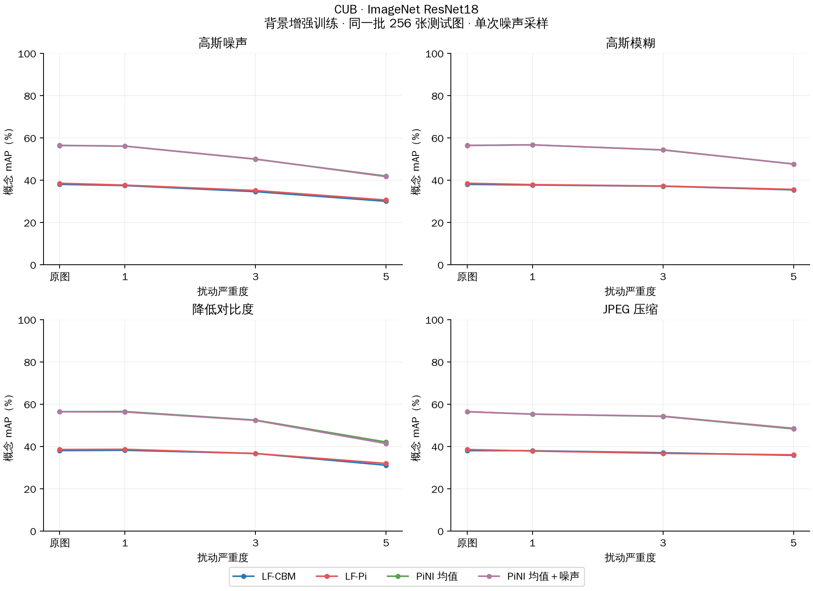
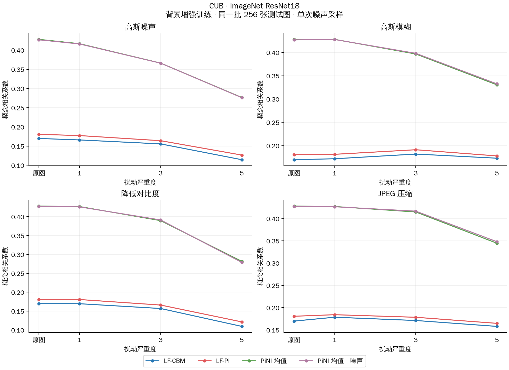
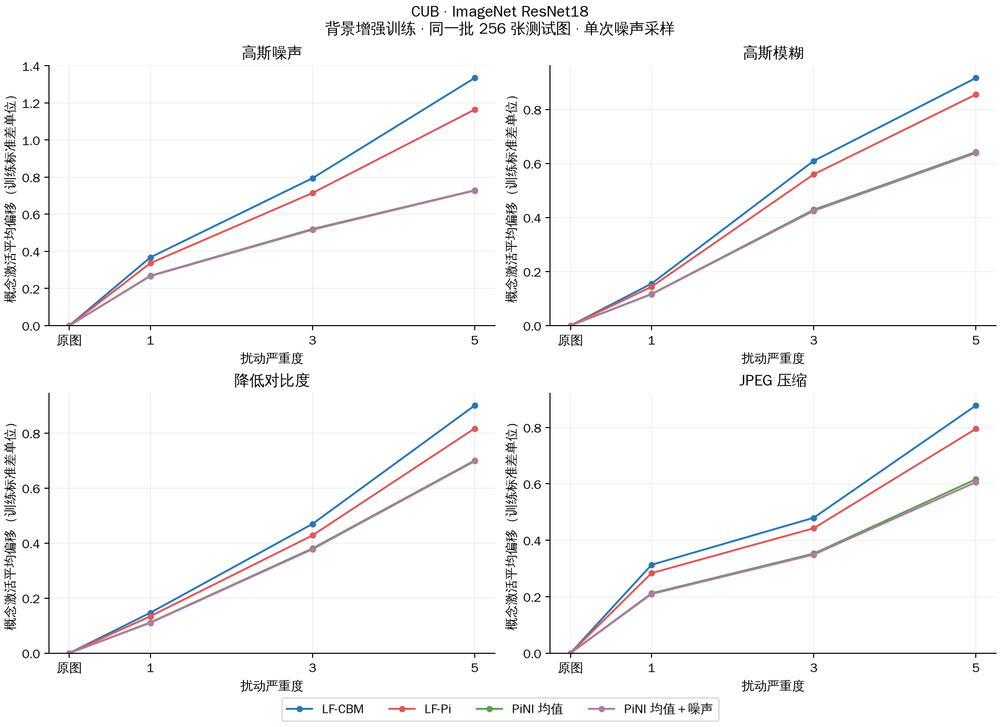
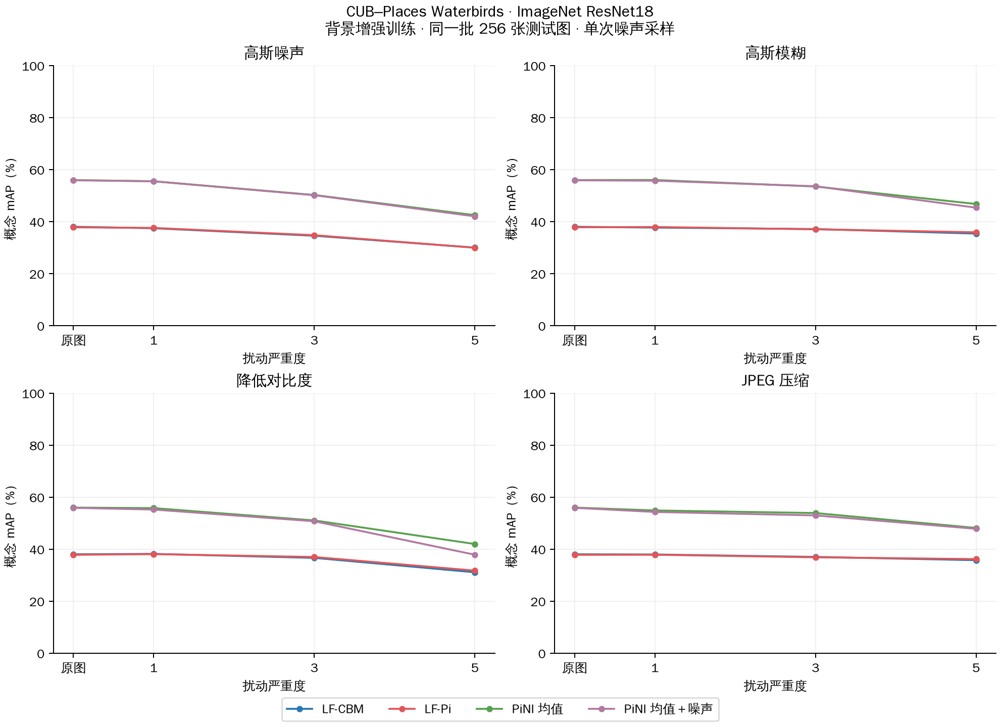
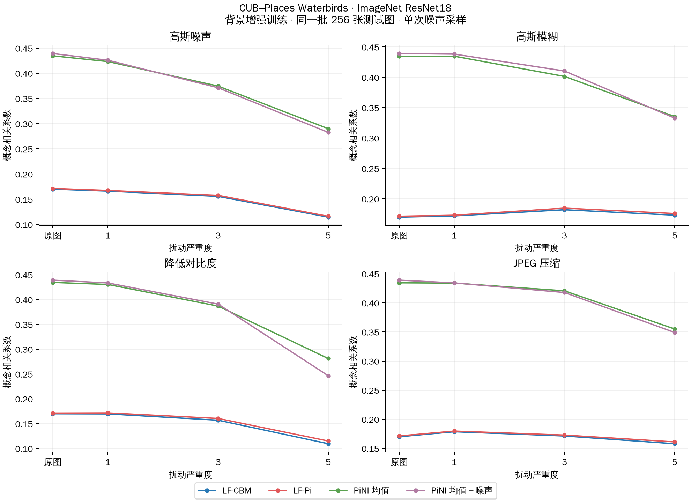
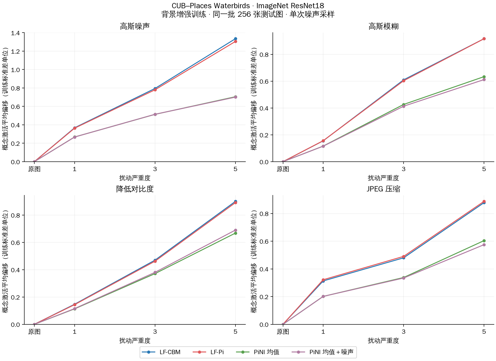

# 图像扰动下的概念预测与激活变化

## RIVAL10

### 概念 mAP（%）

### 概念相关系数

### 概念激活平均偏移（训练标准差单位）

## CUB

### 概念 mAP（%）

### 概念相关系数

### 概念激活平均偏移（训练标准差单位）

## CUB–Places Waterbirds

### 概念 mAP（%）

### 概念相关系数

### 概念激活平均偏移（训练标准差单位）

