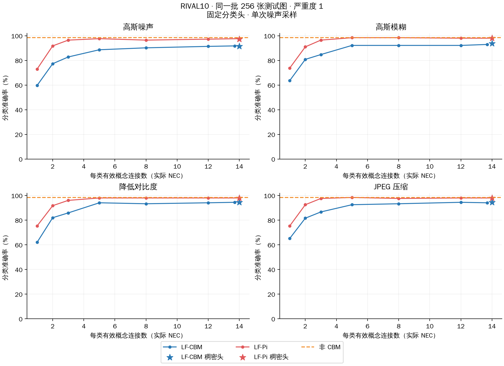
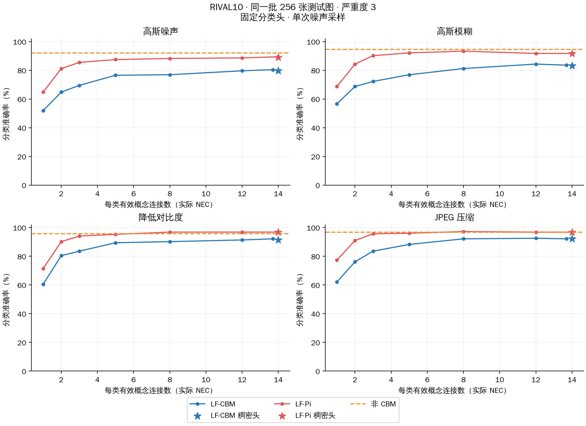
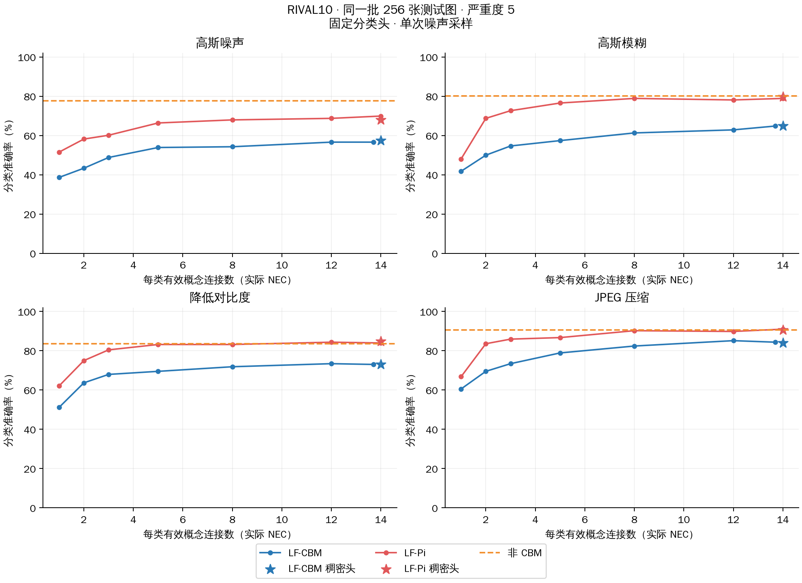
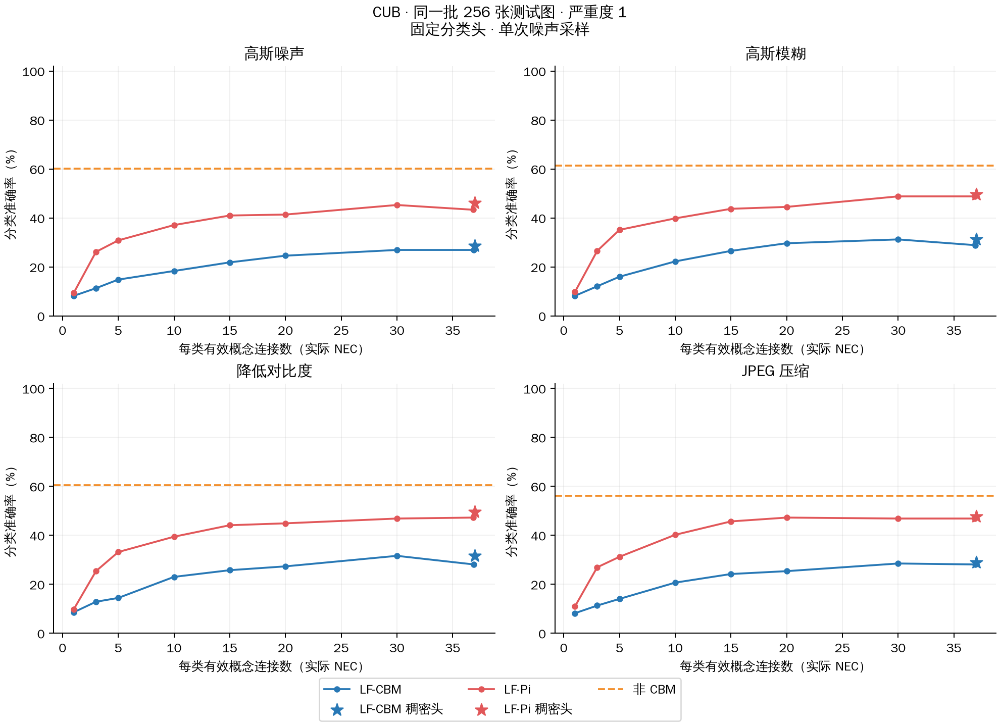
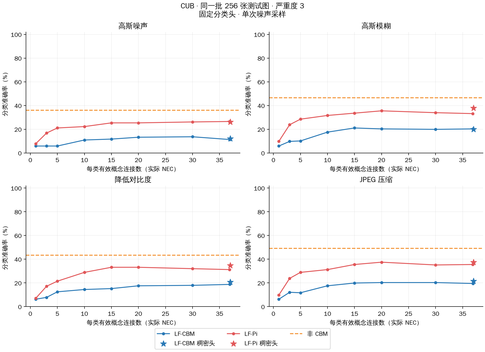
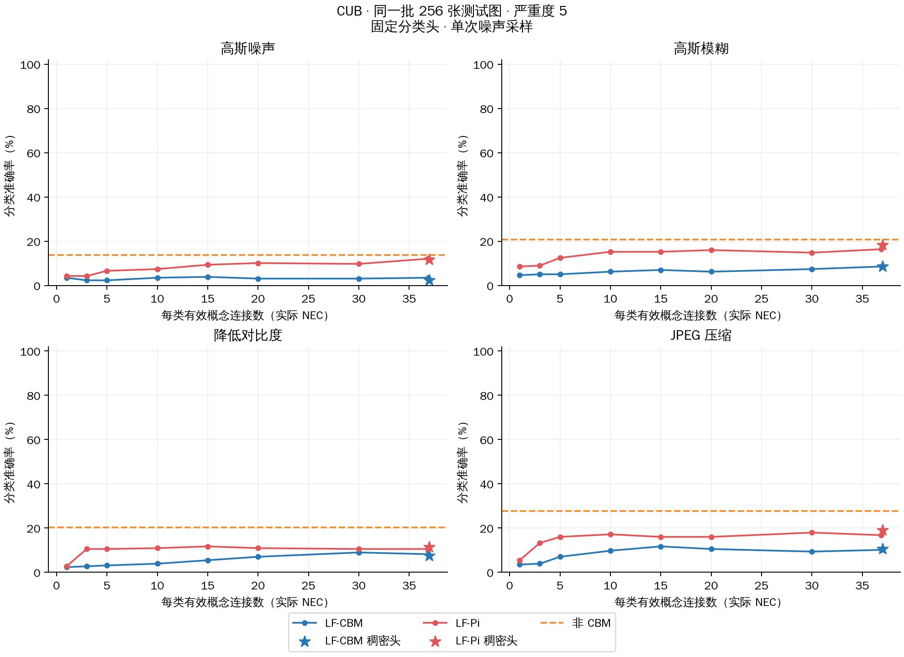
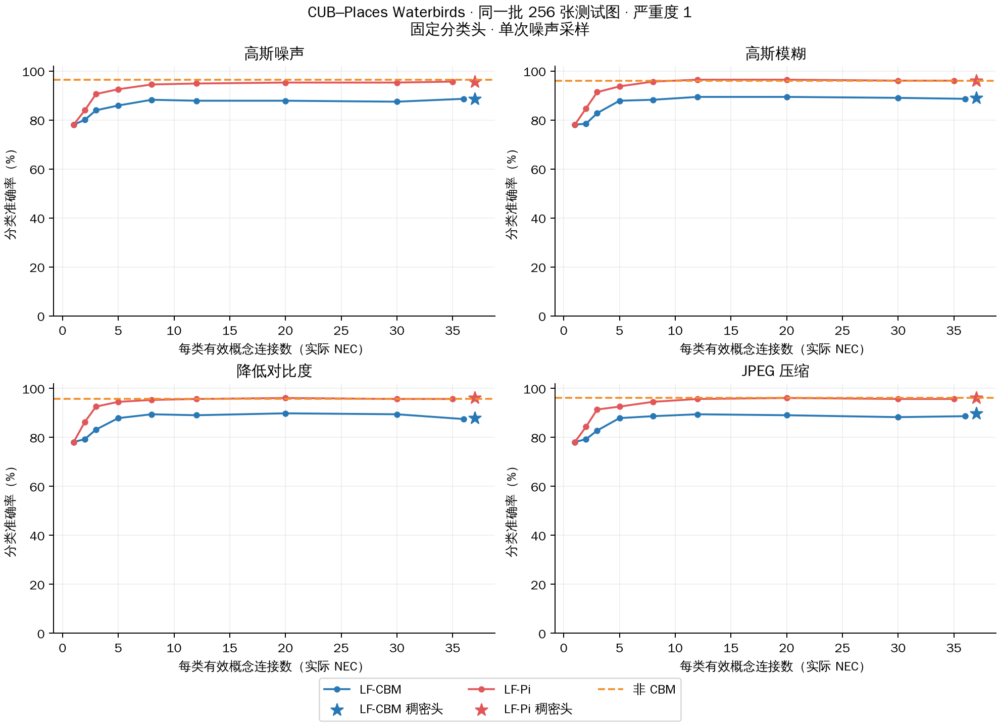
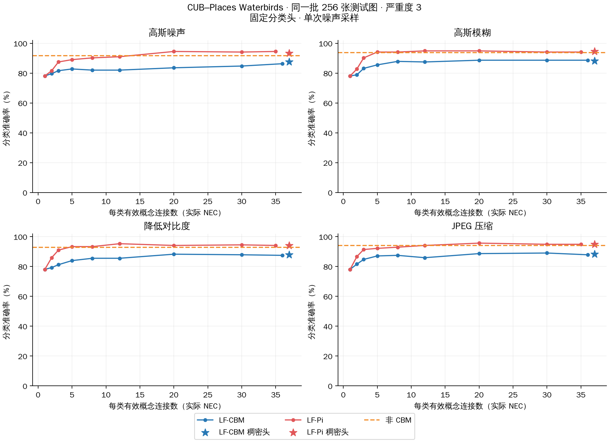
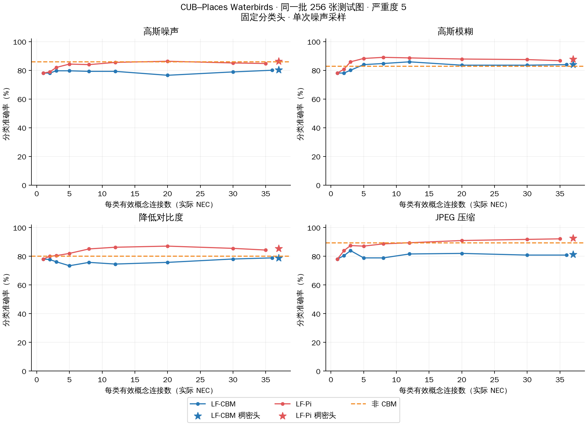

# LF-CBM／LF-Pi 图像扰动下的实际 NEC 曲线

## RIVAL10 · ImageNet ResNet18 · 背景增强训练

### 严重度 1

### 严重度 3

### 严重度 5

## CUB · ImageNet ResNet18 · 背景增强训练

### 严重度 1

### 严重度 3

### 严重度 5

## CUB–Places Waterbirds · ImageNet ResNet18 · 背景增强训练

### 严重度 1

### 严重度 3

### 严重度 5

